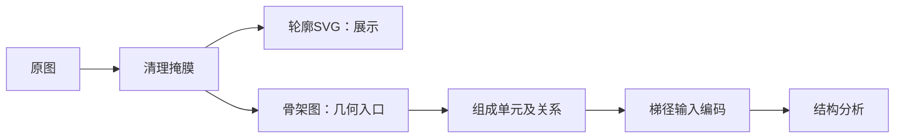

# 小篆实验网页

让本科生从字形出发，拆开结构、读故事、发现联系。先跑通500字，再扩展到2000字和全库。

**唯一维护主线：[Ernest 的仓库](https://github.com/yuernestliu/Seal-Stroke-Split-Visualization)。** 后续开发和网页发布都从这里进行；Yibin仓库仅保留为历史资料来源，不再单独维护或定期同步。

> **学生必读：[学生 To-Do Plan：先完成500字的高质量字形与骨架](docs/项目计划.md)**  
> 首要任务：逐字完成原图清理、高质量轮廓SVG、骨架与拓扑记录，并通过人工核对。组成单元、梯径和其他结构分析使用这批标准结果继续推进。

**信息入口：** [学生计划](docs/项目计划.md) · [500字任务认领](字库/字表/500字任务表.csv) · [全部字库](字库/README.md) · [小篆与《说文解字》资料](资料/小篆与说文解字资料.md) · [学生原资料与梯径参考](资料/部件与笔画/README.md) · [发布说明](docs/发布说明.md)



## 从这里开始

1. 读 [学生 To-Do Plan](docs/项目计划.md)，网页底部也有「学生计划」入口。
2. 在 [500字任务表](字库/字表/500字任务表.csv) 认领字，填写负责人和复核人。
3. 进入 [字形展示](模块/字形展示/README.md)、[字源故事](模块/字源故事/README.md) 或 [字间关系](模块/字间关系/README.md)。

`npm run dev` → <http://127.0.0.1:4186>，也支持直接打开 index.html。默认安；字库默认500字，可切换2000字／全部，分批显示。

## 小篆与《说文解字》资料来源

学生查字形优先用[中研院「小学堂」小篆资料库](https://xiaoxue.iis.sinica.edu.tw/xiaozhuan/)，查释文和形义解释用[港中文「汉语多功能字库」](https://humanum.arts.cuhk.edu.hk/Lexis/lexi-mf/)及其[《说文》全文索引](https://humanum.arts.cuhk.edu.hk/Lexis/lexi-mf/shuowen.php)，核对异体用[教育部《异体字字典》](https://dict.variants.moe.edu.tw/)。原书与段玉裁《说文解字注》的版本线索可查[中国哲学书电子化计划](https://ctext.org/searchbooks.pl?if=gb&searchu=%E8%AA%AA%E6%96%87%E8%A7%A3%E5%AD%97)和[台湾华文电子书库](https://taiwanebook.ncl.edu.tw/zh-tw/book/NCL-004638006)。

完整入口、版本依据、访问核查情况和逐字引用方法见[学生查阅指南](资料/小篆与说文解字资料.md)（2026-10-21整理）。提交时记录具体条目、原书版本与页码、字形对应和复核状态。项目展示用的[崇羲篆体](assets/fonts/LICENSE.md)另有制作与授权说明，与字库字形、古籍书影分别登记。

## 现在做到哪里

| 项目 | 当前状态 |
| --- | --- |
| 原图 | **14,120张**：原大库14,112张，加原实验独有的8张 |
| 候选集 | 按项目BCC字频从现有字形选满500／2000字；500是2000的子集，不是官方常用字标准 |
| 原有流程 | 124字有轮廓SVG和笔段资料，61字有释读资料 |
| 严格平滑笔段 | **只有安、宇、包、光4字**，合字与拆笔共用几何；500字尚未批量完成 |
| 学生新增 | 458字模板及蒙版，属于候选颜色分区，全部待校核 |
| 500字先验 | 已接入500字IDS候选，保留来源；不是小篆像素分割或梯径结果 |
| 梯径 | 两份项目既有数据已集中保存；小篆编码与输入适配待做 |

## 文件地图

```text
字库/
  原始字形/          全部原始小篆图的统一入口
  字表/              500、2000、全部字形、缺字清单与任务CSV
  部件候选/          500字IDS先验，明确未确认
  来源/              BCC字频依据、简繁映射与许可
模块/
  字形展示/          整字、平滑几何、拆笔、候选部件、字库界面
  字源故事/          故事数据与独立展示逻辑
  字间关系/          部件推断、关系规则、关系图与样式
资料/部件与笔画/
  学生资料/          部件CSV、识别结果、IDS、分析报告、原始脚本
  梯径参考/          原3431／6540保留字数据
src/                 薄控制器app.js与字库适配library.js
data/                原124字、模板记录、轮廓SVG和逐字平滑记录
public/assets/       实验过程图、彩色模板快照和部件蒙版
assets/fonts/        未修改的崇羲字体及许可
scripts/             数据构建、检查与预览脚本
docs/                计划、清理Notes、模块约定与来源
research/、archive/   原算法工程与旧版页面
```

## 整合与工作边界

2026-10-21整合Yibin仓库 `29c8b11d6f9dc57770144c60e4de85aa6138048d` 的新增内容，保留Ernest的124字、四字平滑几何、故事和授权。没有拼接两边无共同祖先的Git历史。见 [整合来源](docs/整合来源.json) 与 [学生资料说明](资料/部件与笔画/README.md)。

500／2000只存索引，不复制两套原图。彩色模板、实验中间图属于派生资源，不替换原图。原字频Top500缺20字；项目500候选选到源字频第521位。缺字独立登记，简繁自动映射保持待核。

```sh
npm run dev
npm run build:library
npm run check
npm test
npm run build:pages
```

build:library重建字表、任务表、浏览与先验索引，保留任务表里已有的负责人／复核人／备注。逐字清理按 [GLYPH-CLEANUP](docs/GLYPH-CLEANUP.md)；不要手改生成的data/glyphs.js，不要多人同时修改汇总JS。

## GitHub Pages 发布

网页是纯静态HTML、CSS、JavaScript与资源，不需要后端。已准备 [发布工作流](.github/workflows/pages.yml)：在仓库 Settings → Pages 把 Source 设为 GitHub Actions，再将本地修改提交并推送到main，即可触发发布。完整步骤见 [发布说明](docs/发布说明.md)。

部署地址：[在线网站](https://yuernestliu.github.io/Seal-Stroke-Split-Visualization/) · [学生计划网页](https://yuernestliu.github.io/Seal-Stroke-Split-Visualization/plan.html)。发布状态见仓库Actions；GitHub上的学生计划Markdown入口不依赖Pages。

**网页只发布展示内容。** 发布器从页面依赖生成产物，只导出必要的展示字段、几何、字形图片及字体；完整数据库、原始CSV／JSON、逐字研究记录、处理参数和算法资料保留在仓库，不部署到Pages。

授权见 [页面说明](license.html)、[字体许可](assets/fonts/LICENSE.md)、[字频来源](字库/来源/字频来源.json)。

## 下一位接手者

先读本README和项目计划，只认领500候选中的少量字；原图、轮廓、笔段、部件、故事分别记录状态。用完整字形ID交付样本和核对证据，再由整合者发布共享文件。不要把模板、现代IDS和小篆真实笔画当成同一种证据。
